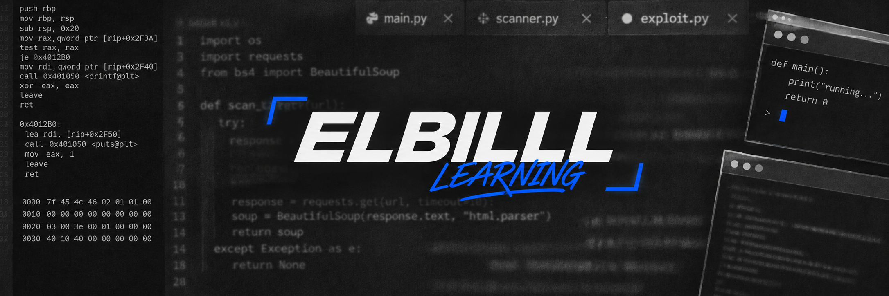

  
  <a href="#about">About</a> •
  <a href="#what-i-do">What I Do</a> •
  <a href="#projects">Projects</a> •
  <a href="#github-stats">GitHub Stats</a> •

  
  
  
  

## About Me

I'm a software engineering student who enjoys exploring how software works under the hood, building practical applications, and learning by experimenting with real projects.

My interests span Android development, backend engineering, developer tooling, automation. I like turning ideas into working software, understanding the systems behind the tools I use, and improving through every iteration.

> I'm still learning, still experimenting, and still building. Every project is another opportunity to understand something better.

---

  

### Android & Application Development

Building Android applications and practical mobile tools using Kotlin, Flutter, and Dart, with attention to offline workflows and everyday usability.

### Backend

Working with PHP, Laravel, Python, and HTTP APIs to connect application features, services, and data.

### Developer Tools & Automation

Experimenting with local tools, AI-assisted development workflows, HTTP relays, and reusable agent skills.

---

  

<table width="100%">
  <tr>
    <td width="50%" valign="top">
      <h3><a href="https://github.com/Nbill27/openclone">OpenClone</a></h3>
      

        
        
      

      An open-source Android app cloning utility that creates a separate, installable APK from an app already on the device — without root, ads, accounts, or a remote server.
      

    </td>
    <td width="50%" valign="top">
      <h3><a href="https://github.com/Nbill27/Inventra">Inventra</a></h3>
      

        
        
      

      An offline Android application for tracking equipment loans, due dates, returns, and overdue items. Uses SQLite, with reminders and spreadsheet import/export.
      

    </td>
  </tr>
  <tr>
    <td width="50%" valign="top">
      <h3><a href="https://github.com/Nbill27/academic-writing-skills">academic-writing-skills</a></h3>
      

        
        
      

      A collection of five agent skills for Indonesian academic writing, covering outlines, drafts, editing, and audits for theses, journal articles, internship reports, and technical reports.
      

    </td>
    <td width="50%" valign="top">
      <h3><a href="https://github.com/Nbill27/hushwire">hushwire</a></h3>
      

        
        
      

      A single Go binary for local network discovery and browser-controlled device isolation, designed for network operations and controlled lab testing.
      

    </td>
  </tr>
</table>

  

---

  

  
  

  

---

  <i>"Always learning. Always building."</i>
    
  

  

