  

  

   

---

## ABOUT ME

 I build practical web and mobile applications with a focus on backend logic, API integration, and database design.

I enjoy turning ideas into working software, developing features that solve real-world problems, and improving application reliability through testing and iteration.

---

## TECHNOLOGY STACK

### Backend Engineering

  

### Android Development

  

### Web Technologies

  

### Development Tools

  

---

## SELECTED PROJECTS

  
    <b>Project Pemula yang lagi gabut saja.</b>
  

<table width="100%">
  <tr>
    <td width="50%" valign="top">
      <h3>
        <a href="https://github.com/Nbill27/muse-opencode">
          muse-opencode
        </a>
      </h3>
      

        
        
      

      A local OpenAI-compatible HTTP relay that drives muse.ai's web chat
      through a real Chromium tab via the Chrome DevTools Protocol
      letting any OpenAI client use muse.ai without an official API key.
      

        
      

      
    </td>
    <td width="50%" valign="top">
      <h3>
        <a href="https://github.com/Nbill27/opencode-deepseek-web">
          opencode-deepseek-web
        </a>
      </h3>
      

        
        
      

      Bridges the free DeepSeek web chat into an OpenAI-compatible backend
      for OpenCode, pacing requests on loopback so an autonomous coding
      agent doesn't get the account flagged.
      

        
        
      

      
    </td>
  </tr>
  <tr>
    <td width="50%" valign="top">
      <h3>
        <a href="https://github.com/Nbill27/academic-writing-skills">
          academic-writing-skills
        </a>
      </h3>
      

        
        
      

      Five Agent Skills that carry an Indonesian academic document from
      outline to submission theses, journal articles, internship and
      technical reports — adapting to any campus's rules via a guide file.
      

        
      

      
    </td>
    <td width="50%" valign="top">
      <h3>
        <a href="https://github.com/Nbill27/hushwire">
          hushwire
        </a>
      </h3>
      

        
        
      

      A single Go binary that scans the local subnet and cuts individual
      devices off the network via ARP poisoning, controllable from any
      browser. Built for network-ops and lab use, not Wi-Fi deauthing.
      

        
        
      

      
    </td>
  </tr>
</table>

   
  

---

## GITHUB STATISTICS

  
  

 

  

---

## CONTRIBUTION ARCADE

  

  Contribution activity visualized in an arcade-inspired style.

---

  
    
  

